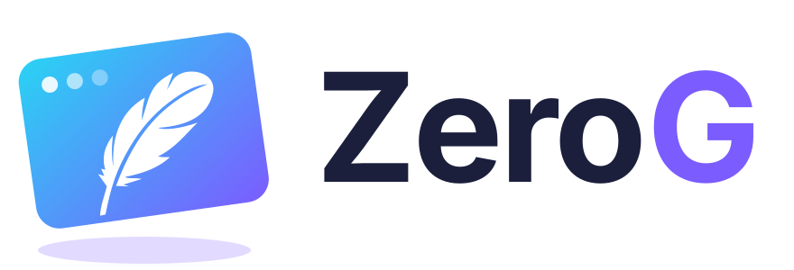

<p align="center">
  <picture>
    <source media="(prefers-color-scheme: dark)" srcset="docs/assets/logo/logo-dark.svg">
    
  </picture>
</p>

<p align="center">
  <b>A single-process WebKit engine with a small, stable C API, linked statically into your application.</b>
</p>

<p align="center">
  <a href="https://github.com/dzonerzy/ZeroG/actions/workflows/checks.yml"></a>
  <a href="https://dzonerzy.github.io/ZeroG/"></a>
  
  
</p>

---

ZeroG is WebKit's WebCore and JavaScriptCore in one process, behind one C header
([`include/zerog.h`](include/zerog.h)), built into one static archive your
program links. The result is a single executable: no helper processes, no IPC,
no runtime to install, and the same rendering on every platform.

- **Desktop apps with a web frontend.** ZeroG opens the window, serves your
  frontend from inside your binary under `app://`, and lets the page call your
  native functions directly, synchronously or with Promises.
- **Game and app overlays.** Texture mode renders into GPU textures your
  renderer composites, on Direct3D 9, 11 and 12, Vulkan and OpenGL, without
  ever blocking your render thread.
- **Headless rendering.** CPU views give you pixels.

## A quick look

```c
#include <zerog.h>

static zg_value *greet(zg_call *call, void *user)
{
    return zg_value_string(call, "Hello from C");   /* JS: App.greet() */
}

int main(void)
{
    zg_runtime_config rc = { sizeof rc };
    zg_context_config cc = { sizeof cc };
    zg_window_config wc = { sizeof wc };

    zg_runtime *rt = zg_runtime_create(&rc);
    zg_context *ctx = zg_context_create(rt, &cc);
    zg_context_mount_assets(ctx, "app", app_assets, app_assets_len);  /* tools/assets.py */

    wc.title = "My App";
    wc.width = 1024;
    wc.height = 768;
    zg_view *view = zg_window_view(zg_window_create(ctx, &wc));
    zg_view_bind(view, "App.greet", greet, NULL);
    zg_view_load_url(view, "app://localhost/");

    zg_runtime_run(rt);
    zg_runtime_destroy(rt);
}
```

The full example is [`examples/hello`](examples/hello); the
[getting started guide](https://dzonerzy.github.io/ZeroG/getting-started/) walks
through it.

## Features

- **The web platform**: modern HTML, CSS and JavaScript with the JIT, SVG,
  canvas on the GPU, WebGL and WebAssembly, `<audio>`/`<video>` with royalty-free
  codecs (H.264 and AAC through the OS on Windows), Media Source Extensions,
  Web Audio, localStorage and IndexedDB, the Cache API and service workers,
  WebSockets, HTTP/2.
- **Native bindings**: functions, classes with native instances, Promises
  settled from any thread, binary data without copies, references to JavaScript
  values. An empty synchronous call costs about 0.03 µs.
- **Window mode**: frameless and transparent windows, `--zg-app-region: drag`
  regions, click-through, native context menus, file dialogs, drag and drop,
  the system clipboard, screen readers (UI Automation, AT-SPI).
- **Texture mode**: frames for your renderer on any thread, input from your
  window, animations paced by your frame clock, GPU compositing on the engine's
  own thread.
- **For applications**: your frontend packed into the binary, custom schemes
  answered by your code, strict trust rules for which pages get the bindings,
  the Web Inspector in development builds, symbol files and a relink kit for
  releases.

## Platforms

| | Windows | Linux |
| --- | --- | --- |
| Window mode | Win32 (ANGLE over Direct3D 11) | X11, Wayland (EGL) |
| Texture mode | Direct3D 9, 11, 12, Vulkan | OpenGL (EGL), Vulkan (dma-buf) |
| CPU mode | Yes | Yes |
| Accessibility | UI Automation | AT-SPI |

Windows 10 1809 or later, x64. Linux x86_64 with glibc (the release builds
target an old glibc, so they run on any recent distribution). macOS is planned.

## Profiles and size

| Profile | What it has | Windows | Linux |
| --- | --- | --- | --- |
| `minimal` | the web platform for application UI: no media, WebGL, WebAssembly or service workers | 93.1 MB | 90.2 MB |
| `standard` | everything | 123.0 MB | 124.1 MB |
| `dev` | standard plus the Web Inspector | 125.5 MB | 126.6 MB |

Sizes are a complete application, stripped, with the whole engine inside;
minimal is 26.5 MB compressed for download. See
[profiles and binary size](https://dzonerzy.github.io/ZeroG/guides/profiles-and-size/).

## Building

```sh
python tools/toolchain.py fetch          # the pinned LLVM (Windows)
python tools/webkit.py fetch             # WebKit at WEBKIT_REVISION
python tools/webkit.py prepare           # the patch series and the port
python tools/build.py all --profile minimal
```

The result is `build/zerog-minimal/lib/zerog-engine.lib` (or
`libzerog-engine.a`): link it with the system libraries listed next to it.
Linux builds run in a Docker image. The first build takes a few hours and
about 100 GB of disk. See [building](https://dzonerzy.github.io/ZeroG/getting-started/building/).

## Documentation

**[dzonerzy.github.io/ZeroG](https://dzonerzy.github.io/ZeroG/)**: getting
started, guides (window mode, texture mode, game overlays, bindings, storage,
security...), the C API reference generated from the header, the design notes,
testing and measurements. The sources are in [`docs/`](docs/).

## Status

The C API is at **0.3, frozen**: within 0.x versions add functions, enum
values and fields at the end of config structs, and never rename, remove or
change meaning without a new minor version
([changes](docs/api-changes.md)). Windows and Linux are complete; a Zig
framework for desktop apps and the macOS port come next.

## License

ZeroG's own code (the port, the embedding layer, the C API and the tools) is
under the BSD 2-Clause license ([LICENSE](LICENSE)). WebCore and
JavaScriptCore, which ZeroG links, are LGPL: applications that link them
statically must let their users relink with a modified engine, which ZeroG's
[relink kit](https://dzonerzy.github.io/ZeroG/guides/licensing/) makes simple.
Every other component keeps its own license: their notices, which applications
ship with the engine, are in [THIRD_PARTY_NOTICES.txt](THIRD_PARTY_NOTICES.txt)
(regenerated by `tools/notices.py`); files derived from other sources are
listed in [PROVENANCE](docs/PROVENANCE.md).
